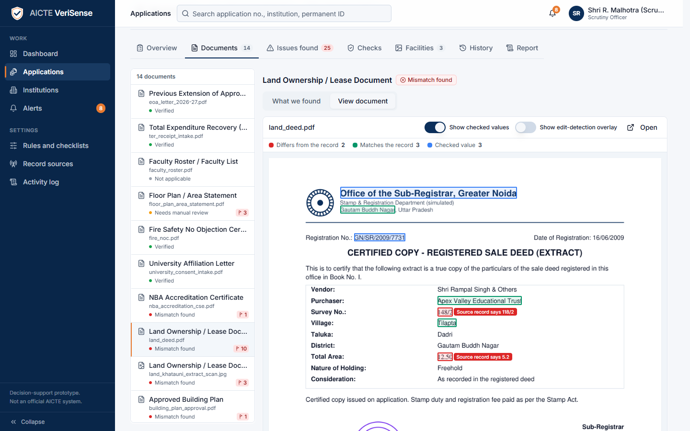
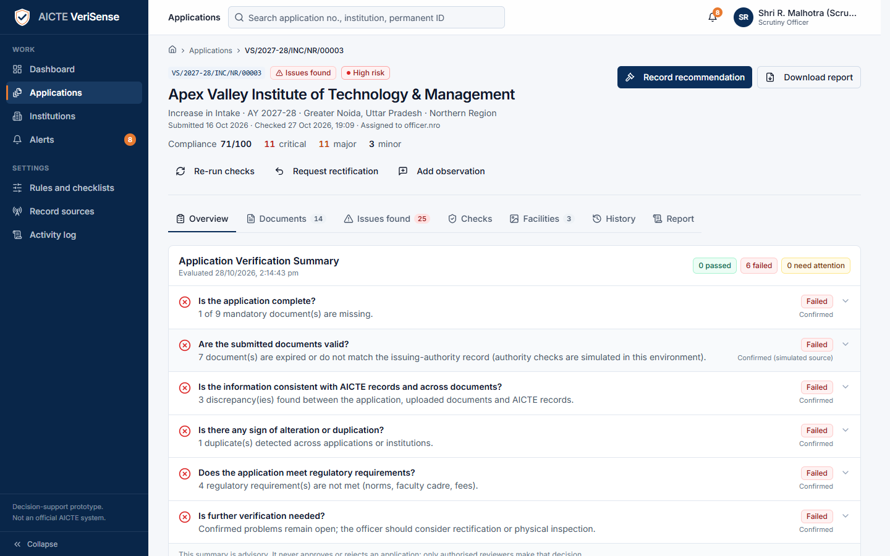
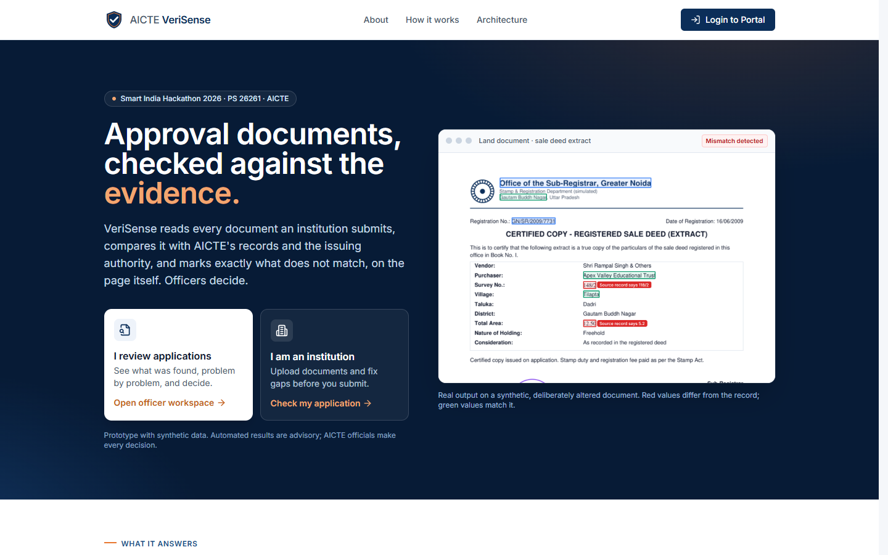
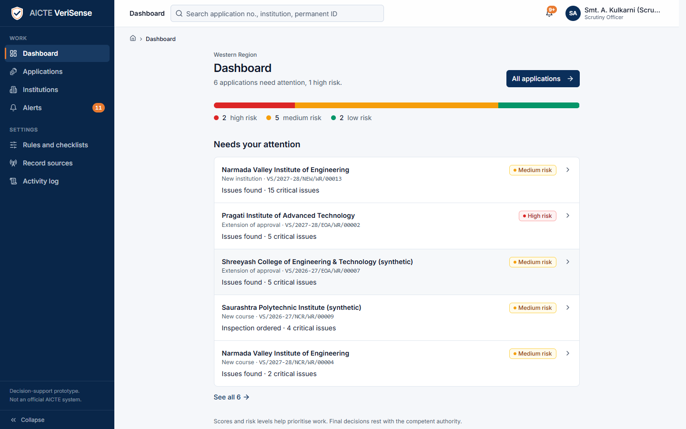
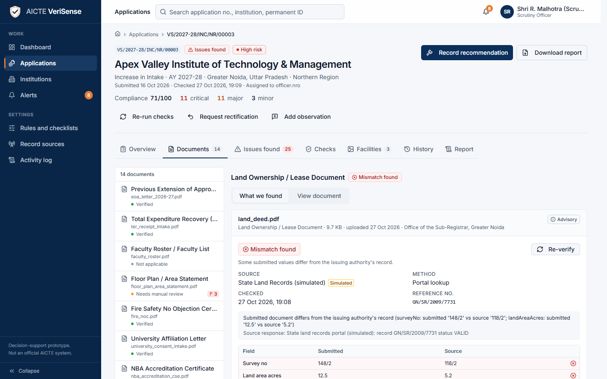
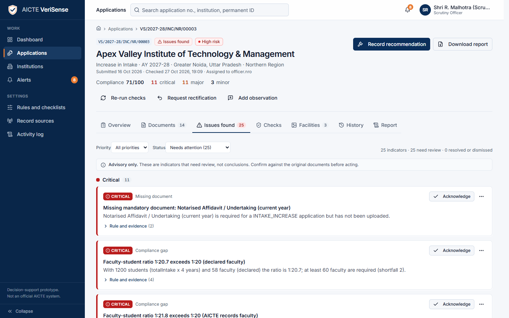
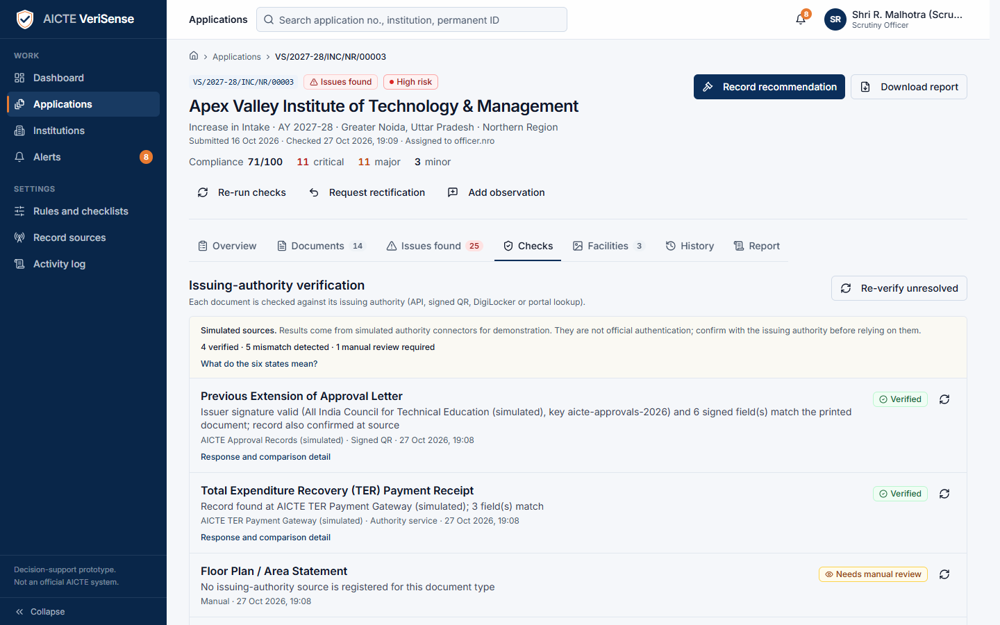
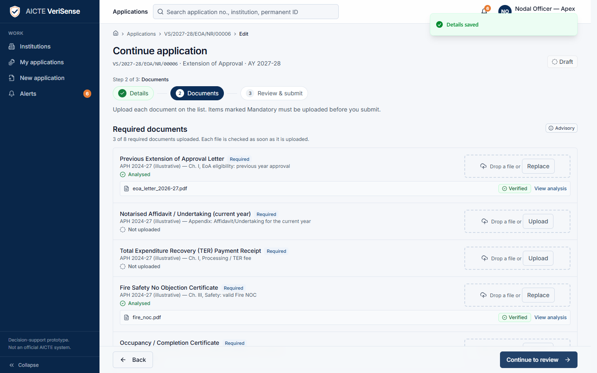
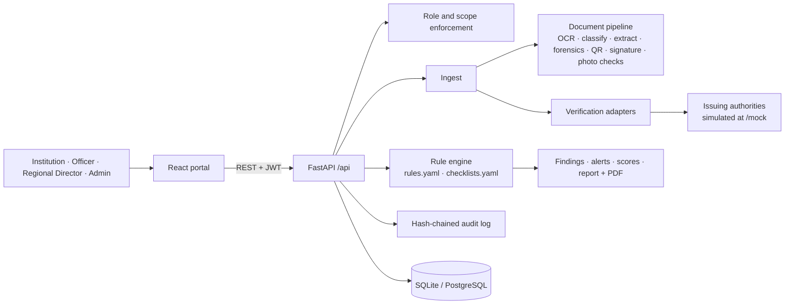

# AICTE VeriSense

**Approval documents, checked against the evidence. Every flag is shown on the page, and every decision stays with an AICTE official.**

VeriSense is a decision-support platform for the preliminary scrutiny of AICTE approval applications. It reads every
document an institution uploads, compares it with the records AICTE already holds and with the authority that issued it,
looks for signs of alteration or reuse, applies the Approval Process Handbook rules, and gives the scrutiny officer an
explainable, evidence-linked result. It never approves or rejects anything on its own.

> Smart India Hackathon 2026 · Problem Statement **26261** · *AI-Powered Application Validation, Document Authentication and
> Regulatory Compliance Verification* · AICTE, Regulation Bureau · Theme: Smart Automation.
>
> This is a prototype, not an official AICTE system. All institutions, people, documents and issuing authorities in it are
> **synthetic**.



*A deliberately altered land deed. The survey number and land area are outlined in red, each labelled with what the official
record says. Green values match the record.*

---

## The six questions every scrutiny starts with

Each application opens with an **Application Verification Summary** that answers the six questions in the problem statement.
Each answer shows its reason, its evidence, and *how sure the system is*, and officers can add notes that go into the audit log.

| # | Question | How it is answered |
|---|---|---|
| 1 | Is the application complete? | Category checklist (7 categories) and required fields |
| 2 | Are the documents valid and relevant? | Document type, expiry, and a check against the issuing authority |
| 3 | Does the information match other records? | Declared values against AICTE records and across the documents |
| 4 | Has anything been altered or duplicated? | Edit, metadata, signature and duplicate indicators |
| 5 | Do the regulatory requirements appear satisfied? | 30 configurable Handbook rules, each tied to a clause |
| 6 | Does anything need further verification? | What to confirm, rectify or inspect in person |

Confirmed failures (an expired certificate, a rule violation) are kept separate from **preliminary AI warnings** (forensic
indicators) and from **unavailable sources**. Suspected tampering is always worded as an *indicator*, never as proof.



## Screenshots

| Home | Officer dashboard |
|---|---|
|  |  |
| **What we found on a document** | **Issues, most serious first** |
|  |  |
| **Issuing-authority checks** | **Institution: upload with a checklist** |
|  |  |

## What it does

| Module | Highlights |
|---|---|
| **Application and document validation** | 7 application categories with their own checklists; institutional records pulled in (approvals, intake, faculty, accreditation, land, TER fee, deficiencies, affidavits); PDF text layer plus OCR; document classification; per-type field extraction with source text and page; missing, expired and inconsistent items flagged |
| **Evidence on the page** | Checked values are located on the PDF or scan and boxed: green when they match the record, red when they differ (with what the record says), blue otherwise |
| **Anomaly and potential-forgery indicators** | Error Level Analysis with heatmap; PDF and EXIF metadata (editing software, modified after creation, incremental updates); duplicates across institutions (SHA-256 and perceptual hash); the same faculty PAN at two institutions |
| **Issuing-authority verification** | Ed25519 signed-QR payloads checked against issuer keys and the printed values; reference lookups through one adapter per authority; six recorded states: Verified, Mismatch detected, Expired, Verification pending, Source unavailable, Manual review required |
| **Regulatory and infrastructure compliance** | 30 configurable rules (faculty-student ratio, cadre ratio, land and built-up area, TER payment, record consistency); photo review of infrastructure evidence (counts, blur, lighting, EXIF date, GPS distance), advisory only |
| **Roles, audit and safeguards** | Server-side role and scope enforcement; SHA-256 hash-chained, append-only audit log; PAN masking; mandatory note on every decision; approval blocked while critical findings are open |

**Human authority is part of the design.** Officers recommend; only the Regional Director records a final decision, with a
mandatory note; approval is blocked while any critical finding is unresolved; institutions cannot mark their own findings
resolved.

## What is real, and what is simulated

| Real in this prototype | Simulated or not built |
|---|---|
| OCR, classification, field extraction | Issuing-authority registries and AICTE institutional records are **seeded, simulated sources** behind adapters, always labelled as simulated |
| Error Level Analysis, metadata, duplicate and cross-institution checks | Signed-QR issuer keys are synthetic |
| Ed25519 signed-QR verification and printed-value comparison | No live DigiLocker, NBA, land-records or SSO integration |
| Rules engine, scoring, findings, six-state verdicts | PDF digital-signature (PAdES) validation is not built |
| Role-based access, scoping, hash-chained audit log | Interface is English only |

## Measured results (synthetic data)

Numbers below are stored in [`samples/evaluation.json`](samples/evaluation.json) (generated 26 Oct 2026, reproducible with
`cd backend && uv run python evaluate.py`). They describe a synthetic set built for this prototype, **not** real-world accuracy.

| Measure | Result |
|---|---|
| Field extraction (normalised) | 225 / 227 (99.1%) |
| Document classification | 56 / 56 |
| Verification states as expected | 42 / 42 |
| Source mismatches found | 5 / 5, no false alarms |
| Forensic indicators: precision / recall | **100% / 41.7%** (5 true positives, 0 false positives, 7 missed, 8 correctly clean, on 20 fixtures) |

The forensic recall is low and we say so: the indicators are conservative, a missed edit is a known limitation, and no result
is presented as proof of forgery.

## Run it

Requirements: Python 3.11 with [uv](https://docs.astral.sh/uv/), Node.js 18+.

```bash
# Backend: http://localhost:8001 (seeds demo data on first start)
cd backend
uv sync
uv run uvicorn app.main:app --port 8001

# Frontend: http://localhost:5176 (proxies /api to the backend)
cd frontend
npm install
npm run dev
```

Or with Docker: `docker compose up --build` (serves everything on port 7860).

- Portal sign-in: <http://localhost:5176/portal/login> · API docs: <http://localhost:8001/docs>
- Reset demo data: `cd backend && uv run python -m seed.seed --reset`
- Tests: `cd backend && uv run pytest` (80 tests) · `cd frontend && npm test` (13 tests) · browser walk-through: `cd frontend && node scripts/smoke-ui.mjs`

### Demo accounts

All accounts use the password **`Demo@2026`**.

| Username | Role | Use it to |
|---|---|---|
| `inst.nvie` | Institution (Narmada Valley) | Upload a complete, clean application |
| `inst.piat` | Institution (Pragati) | See an application with hidden rule violations |
| `inst.apex` | Institution (Apex Valley) | See tampered documents and a draft being corrected |
| `officer.wro` / `officer.nro` | Scrutiny officer (Western / Northern region) | Review applications and recommend |
| `rd.wro` | Regional Director | Record the final decision |
| `admin` | Administrator | Rules, sources and the audit log |

A seven-minute walkthrough is in [docs/DEMO_SCRIPT.md](docs/DEMO_SCRIPT.md). Synthetic test documents, including clean,
tampered and incomplete sets, are in [`samples/`](samples/).

## Architecture



```text
backend/    FastAPI app, rule engine, document pipeline, adapters, simulated authorities, seed data, tests
frontend/   React + TypeScript portal and public site
samples/    Synthetic documents (clean, tampered, incomplete) and the evaluation data
docs/       Architecture, how it works, API, rules, security, user guide, demo script
```

More detail: [Architecture](docs/ARCHITECTURE.md) · [How it works](docs/HOW_IT_WORKS.md) · [API](docs/API.md) ·
[Rules and checklists](docs/RULES_AND_CHECKLISTS.md) · [Verification sources](docs/VERIFICATION_SOURCES.md) ·
[Security and safeguards](docs/SECURITY_AND_SAFEGUARDS.md) · [User guide](docs/USER_GUIDE.md) ·
[Problem-statement mapping](docs/PS_MAPPING.md)

## Roadmap

- Authorised integrations with real issuing authorities (DigiLocker, NBA/NAAC, state land records, ICAI UDIN).
- PDF digital-signature validation against the CCA India roots, with a revision timeline ("signed, then edited").
- Hindi and other Indian-language screens; AICTE single sign-on.

## License

MIT. See [LICENSE](LICENSE).
